# Guion para presentar el sistema a un cliente (≈ 12 minutos)

Negocio de muestra: **Flama Smash**, una hamburguesería ficticia con 14 días de ventas, gastos, compras e inventario.
Preparar: `scripts/demo-iniciar.ps1` (o `-Recargar` para dejar todo como el primer día). Entradas: Admin 1234 · Caja 1 1111 · María 2222 · Carlos 3333.

**Idea central para repetir:** *«Vendes en segundos, sabes cuánto ganas de verdad y nada se pierde sin que te enteres.»*

Antes de empezar pregunta al cliente cómo lleva hoy sus ventas y su inventario (cuaderno, Excel, de memoria). Anota dos dolores y vuelve a ellos al cerrar.

---

## 1. Entrar: cada persona con su PIN (1 min)

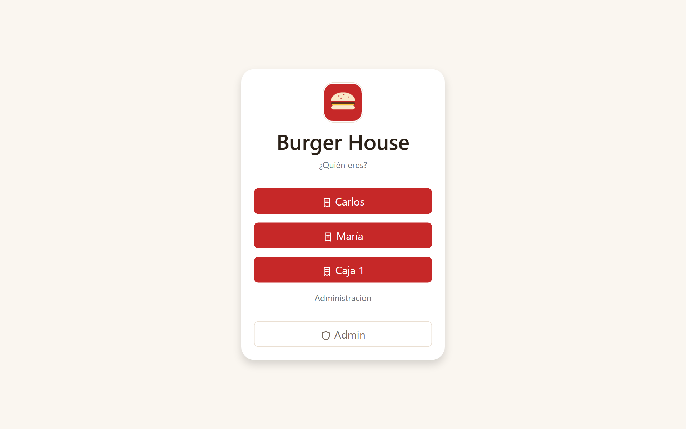

> «Cada persona entra con su nombre y un PIN. No hay contraseñas complicadas, y lo que ve cada una depende de su rol. Hoy entro como **Caja 1**.»

## 2. Vender (2 min)

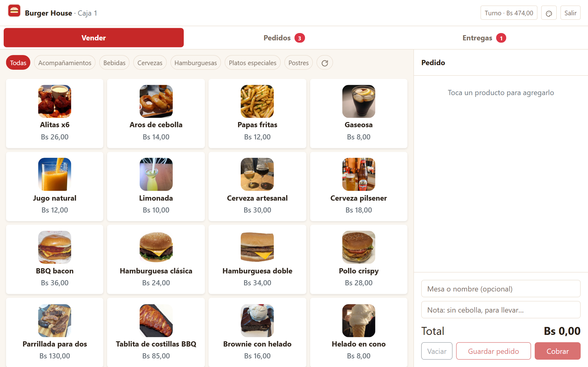

> «Esta es la pantalla de caja. Los productos tienen foto, así se vende más rápido y no hay confusión entre platos. Arriba están las categorías: hamburguesas, platos especiales, cervezas…»

Toca para armar la **Mesa 7**: 2 clásicas, papas, gaseosa y una tablita de costillas.

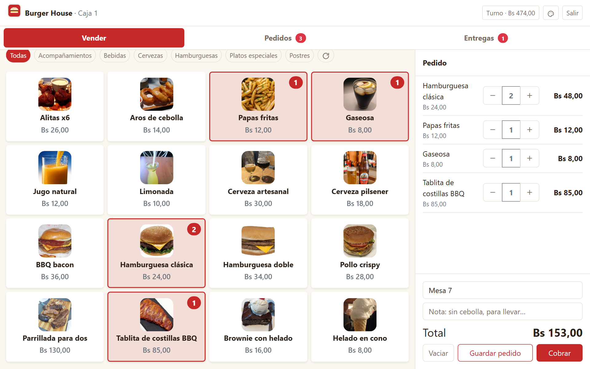

> «Toco un producto y se agrega. Puedo poner mesa o nombre, y una nota como "sin cebolla". Total: Bs 153. Puedo **cobrar** ahora o **guardar el pedido** y seguir sumando consumo.»

## 3. Pedidos abiertos y entregas (1,5 min)

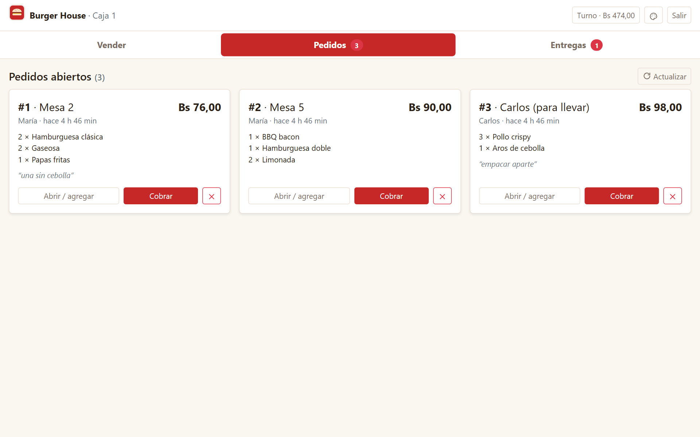

> «Los pedidos guardados quedan abiertos para toda la tienda. El mesero toma el pedido desde su celular y la caja lo cobra al final. Cada pedido dice quién lo tomó y hace cuánto.»

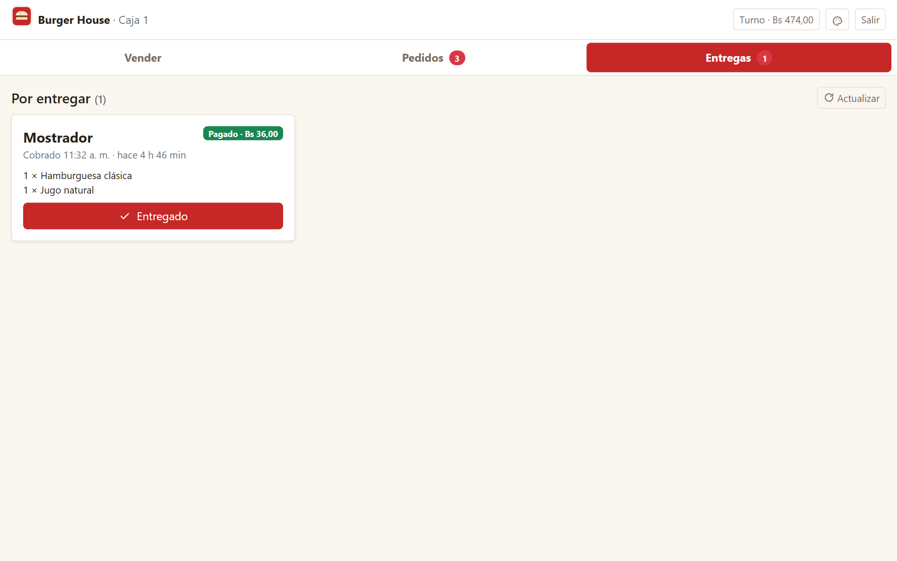

> «Cuando ya se cobró, pasa a *Por entregar*. Quien sirve lo marca como entregado. Así nunca se pierde un pedido pagado que no salió.»

**Celular del mesero** (María): misma app, sin costos ni botón de cobrar.

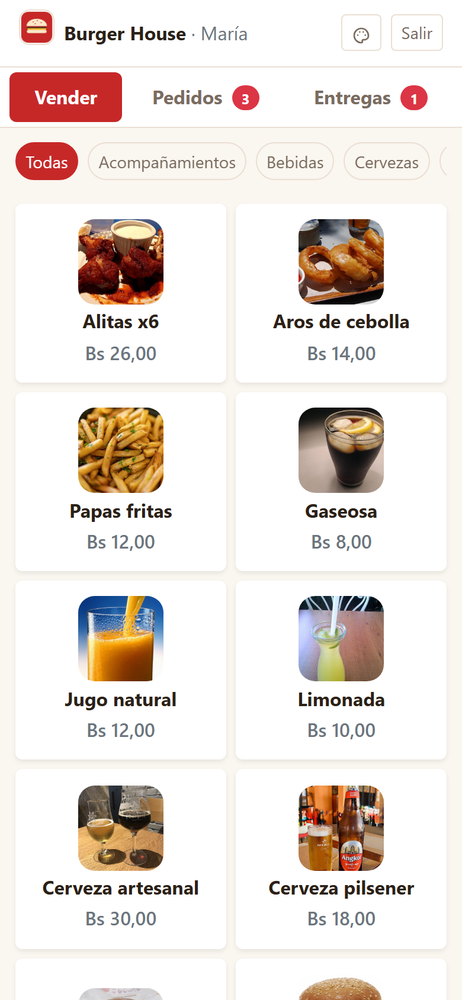

> «El mesero no necesita ningún aparato extra: usa su celular. Y no ve costos ni ventas, solo toma pedidos.»

## 3b. Que el cliente pida desde su mesa (2 min)

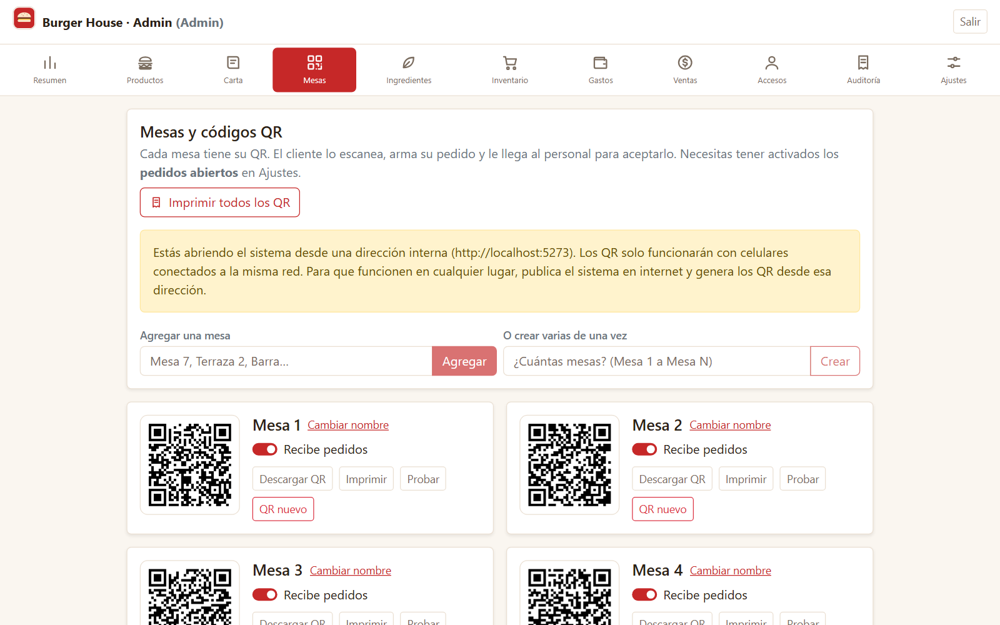

> «Cada mesa tiene su QR, que imprimes y pegas. El enlace es secreto: cambiarle una letra no lleva a otra mesa. El cliente escanea, escribe su nombre y ya puede pedir, sin llamar a nadie. Cuando pagan la cuenta, la mesa se cierra sola y ese celular deja de poder pedir. Si prefieres más control, activas «pedir permiso» y el mesero deja entrar con un toque.»

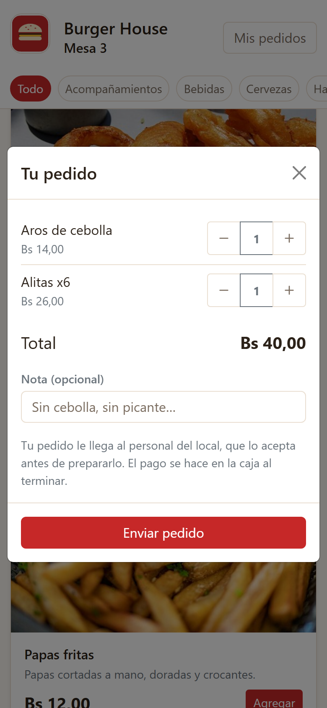

> «El cliente escanea, escribe su nombre, arma su pedido y lo envía. No instala nada ni crea cuenta. Y todo funciona **por la wifi del local, aunque se caiga el internet**.»

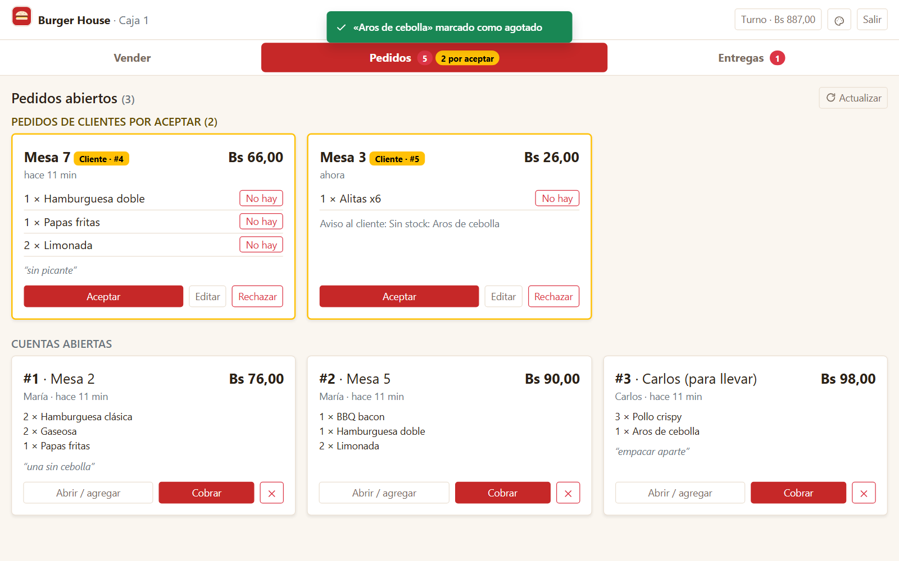

> «A la caja le llega **por aceptar**: puede aceptarlo, editarlo o rechazarlo. Nada se prepara ni se cobra sin que el personal lo acepte. Si algo se acabó, toca **No hay**: se quita del pedido y queda marcado agotado para que nadie más lo pida.»

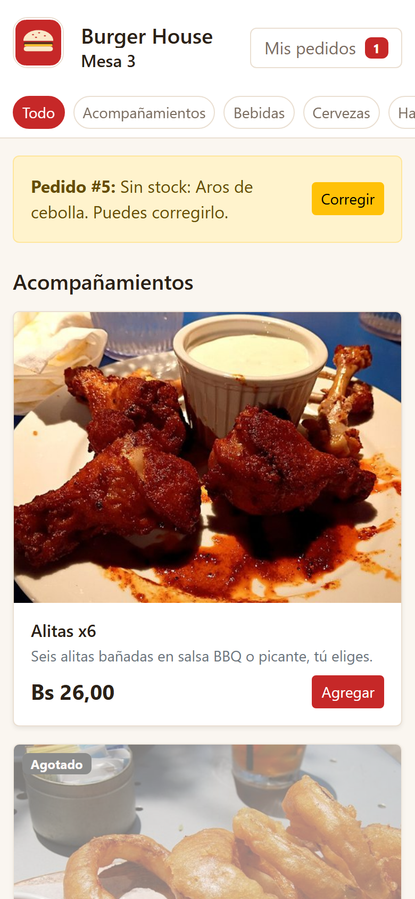

> «El cliente ve el aviso en su celular y puede corregir su pedido. Cuando se acepta, se suma a la cuenta de su mesa y se cobra como cualquier otro pedido.»

## 4. Resumen: cuánto ganas de verdad (1,5 min) — *entrar como Admin*

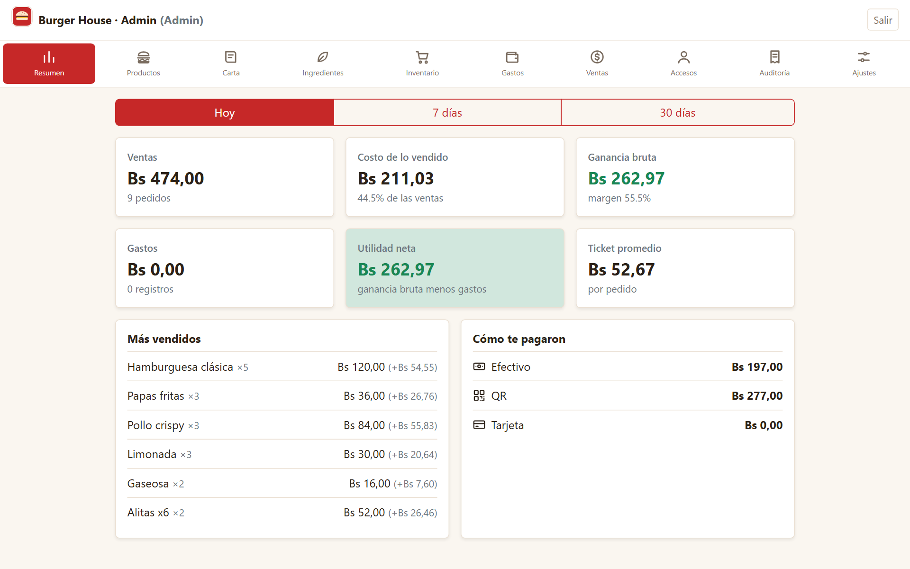

> «Ventas, **costo de lo vendido**, ganancia y **utilidad neta** después de gastos. Hoy: Bs 474 vendidos, Bs 262,97 de ganancia. Aquí no hay que esperar a fin de mes para saber si el día valió la pena. Abajo ves lo más vendido y cómo te pagaron: efectivo, QR o tarjeta.»

## 5. Calculadora de precios (2,5 min) — *el momento fuerte*

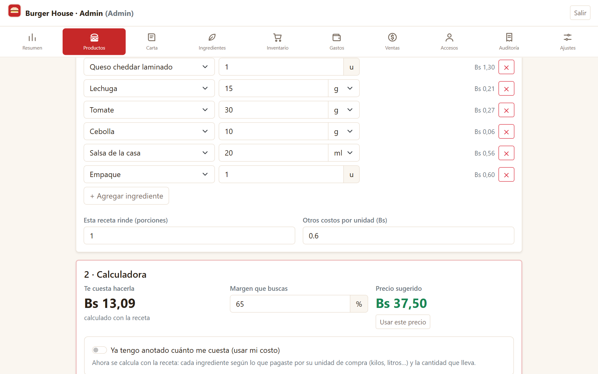

> «Cada producto tiene su receta con lo que lleva. Fíjate: compré la carne por kilo y la hamburguesa usa 120 gramos; el sistema **convierte la unidad solo** y calcula cuánto cuesta cada ingrediente. La clásica me cuesta Bs 13,09.»

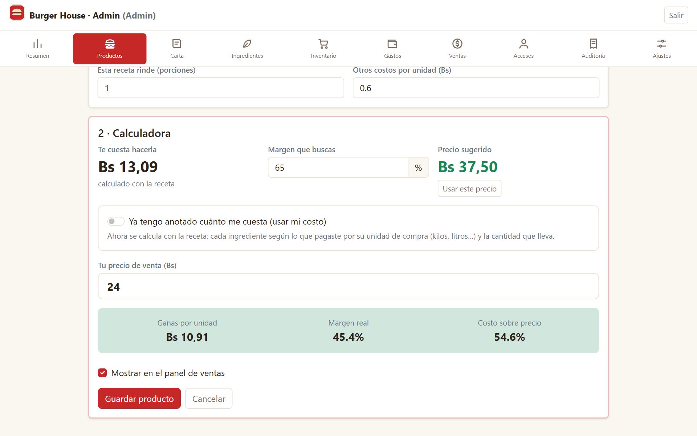

> «Pongo el margen que busco, 65 %, y me **sugiere** Bs 37,50. Hoy la vendo a Bs 24, y gano solo 45 %: ahí veo que estoy regalando margen. Con un toque uso el precio sugerido.
> Y si ya tienes anotado cuánto te cuesta cada plato, activas *"Ya tengo anotado cuánto me cuesta"*: manda tu costo, y la app sigue mostrando el calculado como referencia, avisándote si difieren mucho.»

> «En la lista ves de un vistazo costo, precio y ganancia de cada plato; en verde los que rinden, en amarillo los que conviene revisar.»

## 6. Inventario: lo que debería haber (2 min)

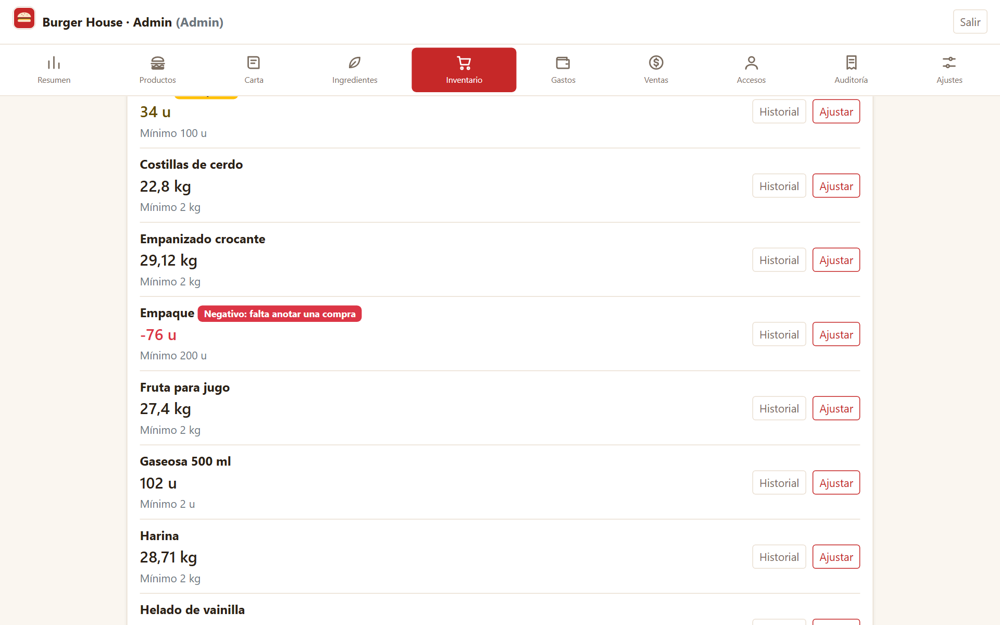

> «Cada venta **descuenta sola los insumos** según la receta. Cuando compras, registras la compra y sube el stock, actualiza el costo y la anota como gasto.
> Mira este: **Empaque en -76**. Se permite negativo a propósito: en un día de mucho trabajo vendes antes de anotar la compra. El sistema no te frena; te avisa *"falta anotar una compra"* y después lo regularizas o haces un **ajuste** con el conteo físico. Todo queda en el historial.»

## 7. Equipo y control (1,5 min)

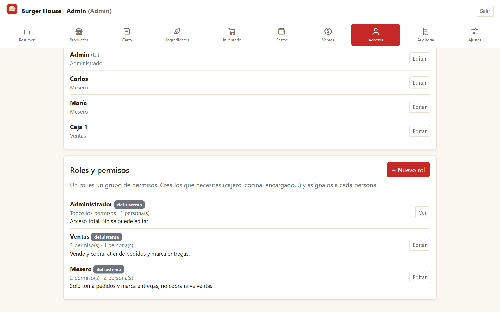

> «Tú decides quién puede qué. Hay roles listos (Administrador, Ventas, Mesero) y puedes crear los tuyos: cajero, cocina, encargado…»

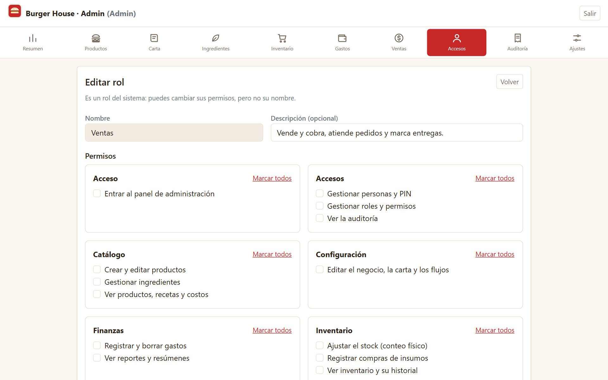

> «Se marcan permisos uno por uno: ver costos, anular ventas, ajustar stock… El administrador siempre tiene todo, para que nadie quede sin acceso.»

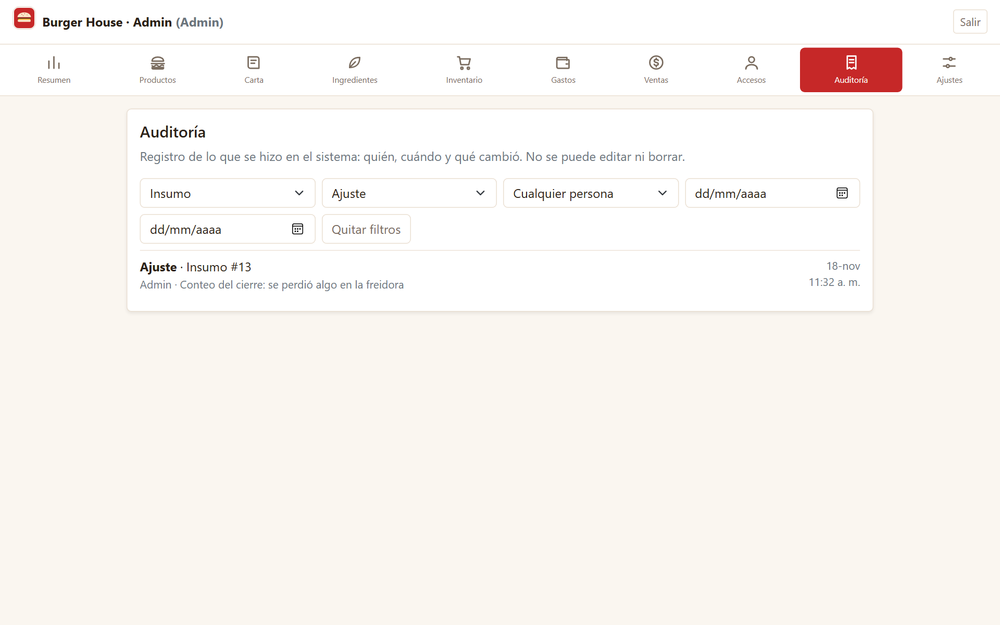

> «Y la **auditoría** guarda quién hizo qué y cuándo: ingresos, ventas anuladas, cambios de precio, ajustes de inventario con su motivo. No se puede editar ni borrar. Si algo no cuadra, sabes quién y cuándo.»

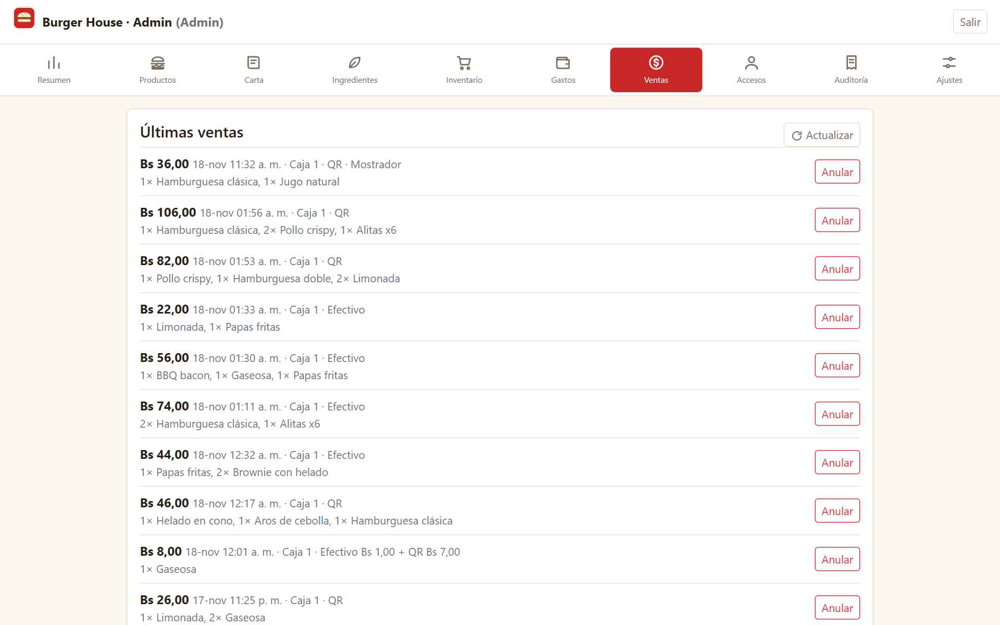

> «Anular una venta es posible, pero deja huella y deja de contar en los reportes.»

## 8. Carta en internet (1 min)

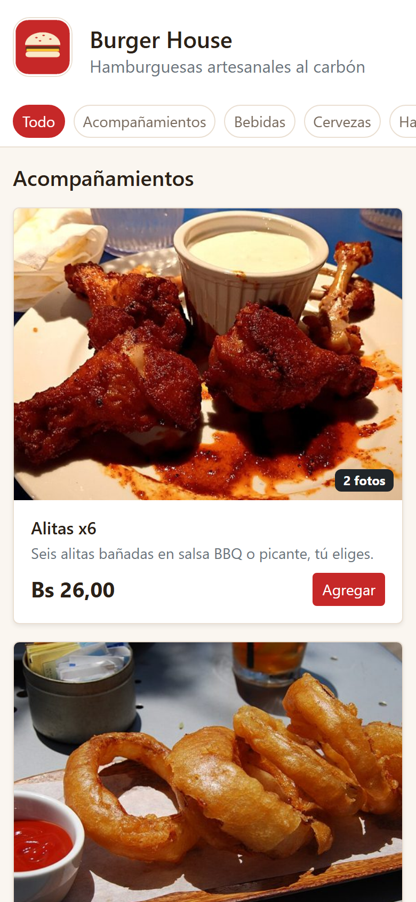

> «Tus clientes abren esta carta desde un enlace o un QR, sin instalar nada. Ven fotos y precios, arman su pedido y se abre WhatsApp con el mensaje listo hacia tu número.»

## 9. Que se vea como tu marca (30 s)

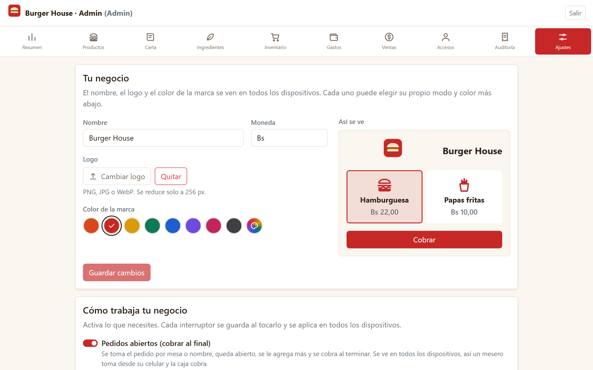

> «Cambias el nombre, el logo y el color; se aplica en todos los dispositivos. Esto que ves es la tienda de muestra: con tus datos queda como tu negocio.»

---

## Cierre (1 min)

Vuelve a los dos dolores que anotó al principio y ligalos a una pantalla: *«Me dijiste que no sabías cuánto ganas por plato: eso es la calculadora. Me dijiste que se te acaba el insumo sin darte cuenta: eso es el inventario.»*

Propón el siguiente paso concreto: levantar **su** carta con su logo y 10 productos y probar una semana. Pregunta cuántas personas atenderían y si necesitan celular para meseros.

## Preguntas que suelen salir

- **¿Funciona sin internet?** El sistema corre en la red del local. Para la carta pública y pedidos por WhatsApp se publica en internet (README, sección de publicación).
- **¿Y si me equivoco en una venta?** Se anula, queda registrada y no cuenta en reportes. Quién la anuló y cuándo queda en auditoría.
- **¿Y si vendo algo sin haber anotado la compra?** El stock queda negativo con aviso y se corrige después con una compra o un ajuste.
- **¿Puedo usar mis propias fotos y precios?** Sí: se suben desde *Productos*. Las fotos de la demo son de ejemplo.
- **¿Pueden entrar mis empleados desde el celular?** Sí, cada uno con su PIN, y ven solo lo que su rol permite.

## Antes de la reunión (lista rápida)

- [ ] `scripts/demo-iniciar.ps1 -Recargar` para tener los datos del primer día.
- [ ] Si el navegador muestra fotos viejas, recarga forzada (Ctrl+F5).
- [ ] Ensayar el recorrido una vez: ~12 minutos sin preguntas, ~20 con ellas.
- [ ] Si la mostrarás desde su celular: misma wifi y `http://IP-DE-TU-PC:5273`.
- [ ] Las fotos vienen de Wikimedia Commons; si publicas la demo, respeta la atribución de `scripts/fotos/CREDITOS.md`.
